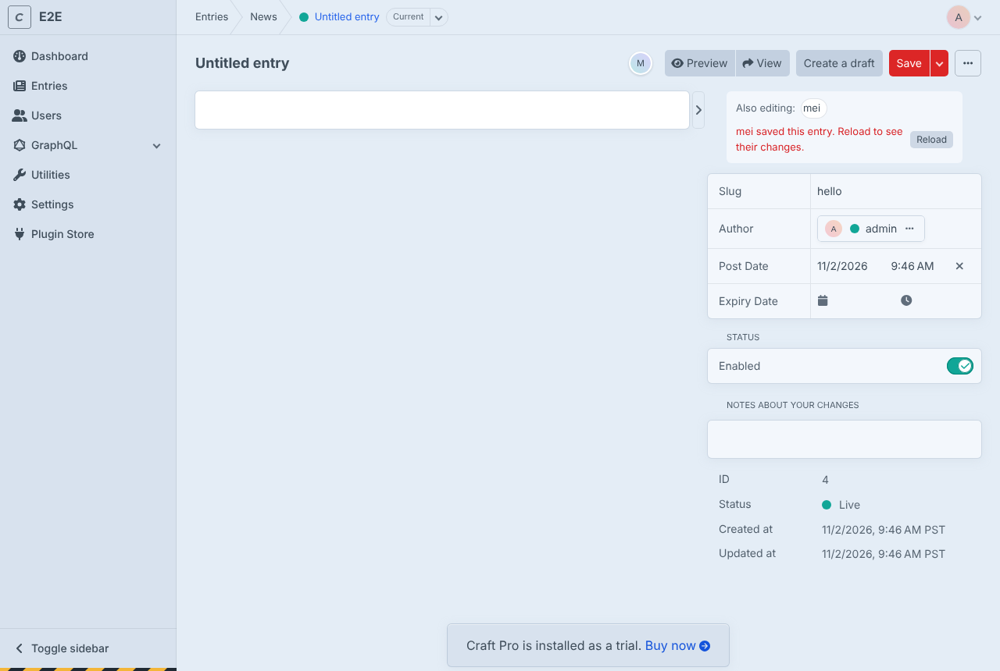

# Hibira Realtime for Craft CMS

Realtime for Craft CMS 5 on [Hibira](https://hibira.io), the hosted WebSocket service that speaks the Pusher Channels protocol. No Node server, no Redis, no queue workers to run.

- **Editing presence.** Entry pages show who else has the entry open the moment they arrive, and when someone else saves it, a reload prompt so nobody overwrites their work.

  
- **Live entries.** Saving a live entry publishes `entry-updated` to `craft-entry-{id}` and `entry-saved` to `craft-section-{handle}`. Mark an element with `data-hibira-entry="{{ entry.id }}"` and readers get a "This page was updated" notice with a Reload button.
- **Craft Commerce.** Order status changes go to `private-craft-order-{number}`, so the order page follows "Shipped" live, and new orders pop up in the control panel for staff who manage orders.
- **Your own events** from Twig or PHP, and signed private and presence channels for your front end.

Requires Craft CMS 5 and PHP 8.2+. The free Hibira plan is enough to start.

## Install

```bash
composer require hibira-io/craft-hibira
php craft plugin/install hibira
```

Create an app at [hibira.io/portal](https://hibira.io/portal), then add its credentials to `.env`:

```bash
HIBIRA_APP_ID=...
HIBIRA_APP_KEY=...
HIBIRA_APP_SECRET=...
```

**Settings → Plugins → Hibira Realtime** reads these variables by default; change the host only if your app lives in another cluster. Add your site's origin (and the control panel's, if different) to **Allowed origins** on the Hibira app page.

## Templates

```twig


<article data-hibira-entry="{{ entry.id }}">
  {{ entry.body }}
</article>
```

`registerScript()` adds pusher-js (served from the plugin) and `window.HibiraCraft`:

```js
HibiraCraft.onSectionSaved('news', (entry) => prependToList(entry));   // id, title, url, section, isNew, dateUpdated
HibiraCraft.onEntryUpdated(42, (entry) => console.log(entry.title));
HibiraCraft.onOrderStatus('{{ order.number }}', ({ status, handle }) => showStatus(status));
HibiraCraft.pusher.subscribe('scores').bind('goal', (d) => console.log(d));
```

Publish from a template or PHP:

```twig

```

```php
use hibira\craft\Plugin;

Plugin::getInstance()->client->trigger(['scores'], 'goal', ['team' => 'home']);
```

`trigger()` returns `false` and logs a warning instead of throwing, so a network hiccup never breaks saving an entry.

## Channels and events

| Channel | Event | Sent when |
|---|---|---|
| `presence-craft-entry-{id}` | members, `entry-saved` | an editor opens the entry in the control panel; saves it |
| `craft-entry-{id}` | `entry-updated` | a live entry is saved |
| `craft-section-{handle}` | `entry-saved` | a live entry in the section is saved |
| `private-craft-order-{number}` | `status` | a Commerce order's status changes |
| `private-craft-cp-orders` | `new-order` | a Commerce order is completed |

Drafts, revisions, disabled and pending entries never publish, so nothing leaks before it is live.

## Your own private and presence channels

`actions/hibira/auth` signs subscriptions. Entry presence needs a signed-in user who can view the entry; an order channel needs the order's 32-character number; `private-craft-cp-orders` needs the *Manage orders* permission. Everything else is refused unless you allow it:

```php
use hibira\craft\controllers\AuthController;
use hibira\craft\events\AuthorizeChannelEvent;
use yii\base\Event;

Event::on(AuthController::class, AuthController::EVENT_AUTHORIZE_CHANNEL, function (AuthorizeChannelEvent $e) {
    if ($e->channel === 'presence-team-room' && $e->user) {
        $e->allowed = true;
        $e->userId = (string)$e->user->id;
        $e->userInfo = ['name' => $e->user->fullName];
    }
});
```

## License

MIT

---

## 中文摘要

Hibira Realtime 是 Craft CMS 5 的即時外掛，不需要自架 Node、Redis 或 queue worker：

- **編輯中提示**：項目編輯頁顯示還有誰開著同一篇，別人儲存時提醒你重新載入，避免互相覆蓋。
- **即時項目**：上線中的項目儲存時，發布 `entry-updated`（`craft-entry-{id}`）與 `entry-saved`（`craft-section-{handle}`）；在模板加 `data-hibira-entry` 就會自動出現「此頁面已更新」提示。
- **Craft Commerce**：訂單狀態變更推到 `private-craft-order-{number}`，訂單頁即時顯示出貨；有新訂單時控制台跳出提醒。
- 可在 Twig 或 PHP 發布自訂事件，也能授權自己的私人與 presence 頻道。

安裝：`composer require hibira-io/craft-hibira` 後在 `.env` 填入 `HIBIRA_APP_ID`、`HIBIRA_APP_KEY`、`HIBIRA_APP_SECRET`。控制台介面支援 7 種語言。
